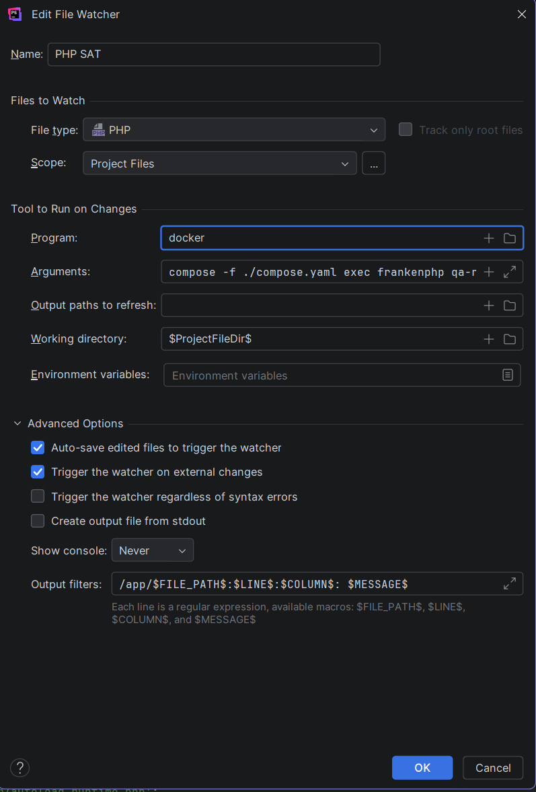
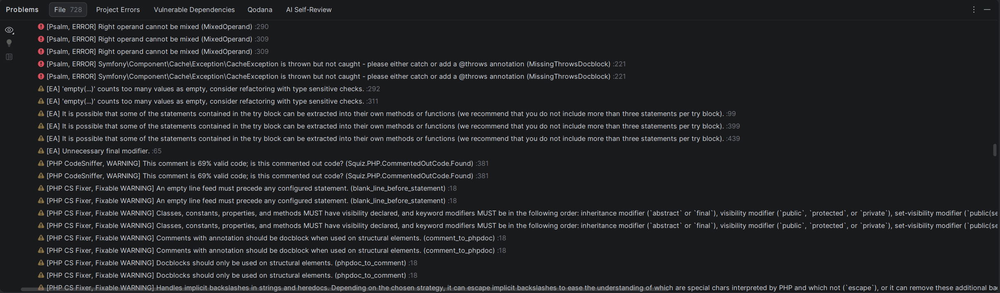

# QARunner

## What?

This is a tool to allow combining output from multiple quality tools into one with primary goal to serve it to an IDE.

Originally generated by Claude, significantly modified, cleaned up and tested manually.

## Why?

When using PHPStorm with multiple quality tools for PHP and PHP interpreter being run in a Docker container I have faced various inconsistencies with their behavior (especially when they are actually triggered or not). I even reported bugs like [WI-86020](https://youtrack.jetbrains.com/issue/WI-86020), [WI-85235](https://youtrack.jetbrains.com/issue/WI-85235) and [WI-84744](https://youtrack.jetbrains.com/issue/WI-84744). I also could not plug in other tools, that are not natively supported by PHPStorm itself (like Rector). But my attempt at integrating Twig CS Fixer through a File Watcher, as well as learning about [ECS](https://github.com/ecsphp/ecs) and [PHPQA](https://github.com/EdgedesignCZ/phpqa) gave me an idea.

## Installation

Same as with most Composer libraries:

```console
composer require simbiat/qa-runner --dev
```

This was written and tested in environment with PHP 8.5, so this one is set as requirement. If your project uses a different version of PHP, and it works fine, please, let me know, I can add it as supported. Also uses Symfony's Process and Console components.

## Usage

This is a command-line tool, so common approach would be

```console
vendor/bin/qa-runner check </full/path/to/File.php>[ </full/path/to/File2.php> </full/path/to/Folder/>...]
```

In PHPStorm you set up a File Watcher with `Program` set as `vendor/bin/qa-runner` and `Arguments` as `check /app/$/FileRelativePath$`. If you are also running the interpreter in Docker you would use `docker` for `Program` and something like `compose -f ./compose.yaml exec frankenphp qa-runner check /app/$/FileRelativePath$` for `Arguments`. In `Output Filters` you set `/app/$FILE_PATH$:$LINE$:$COLUMN$: $MESSAGE$`. The rest of the settings are optional, but this is how it looks in my project:



And this is how it will look in the `Problems` tab, if you do not forget to enable `File Watchers` inspection:



Note, that you may not need the `/app` in prefix for the `Arguments` or `Output Filters` depending on your project setup. Important part here is that the `$FILE_PATH$` filter matches paths from IDE's project perspective. My container mounts the project as `/app`, that's why I add it everywhere to be explicit.

The tool also supports 2 other commands besides `check`:

1. `diff`: shows what the fixers would change. The runner copies each file to a temporary file in the same directory. Then it runs the fixers on the copy, one after another. Each fixer gets the result of the previous one. The output is one combined unified diff for each file, not a separate output for each tool. The original files do not change, and the temporary files are removed at the end.
2. `fix`: uses the same process as `diff`, but replaces each changed original file with its fixed copy. The output of each tool is shown with a styled header, if respective tool failed. The original file is not touched if it changed on the disk during the run (for example, you saved it in the IDE). In this case you get an error, and the fixes for this file are not applied.

Both commands use the commands from the `fix` node of `composer.json` (see below). The order of the adapters in that node is the order in which the fixers run.

The temporary file is in the same directory as the original, with a random part before the extension (`Foo.php` becomes `Foo.qa-runner-1a2b3c4d.php`). The reason: a copy outside the project would not match the filters of the tools. Rules that depend on the file name (for example, a class name that must match the file name) can see the temporary name. If the run is killed (`SIGKILL`), a temporary file can stay in the directory. Delete it by hand.

Due to how they work, `diff` and `fix` accept only files, not directories. Each tool applies its own configuration to the file.

## Customization

While the QA Runner does not need a separate config file, it still requires some configuration, to at least tell it what tools to run.

### Tools selection

Selection of tools (or rather their adapters) you want to run is done through `composer.json`'s `extra` node, where you add a `qa-runner` object with `check` and `fix` attributes (`diff` uses the `fix` attribute). Each of them should be a named array, where key names are fully qualified names of the adapters' classes, and their values are the exact commands to run. To better explain it, here's a snippet of `composer.json`:

```json
{
    "extra": {
        "qa-runner": {
            "check": {
                "Simbiat\\QARunner\\Adapters\\CodeSniffer": "@phpcs",
                "Simbiat\\QARunner\\Adapters\\CSFixer": "@php-cs-fixer",
                "Simbiat\\QARunner\\Adapters\\Stan": "@phpstan",
                "Simbiat\\QARunner\\Adapters\\Psalm": "@psalm",
                "Simbiat\\QARunner\\Adapters\\MessDetector": "@phpmd",
                "Simbiat\\QARunner\\Adapters\\Rector": "@rector",
                "Simbiat\\QARunner\\Adapters\\TwigCS": "@twig-cs"
            },
            "fix": {
                "Simbiat\\QARunner\\Adapters\\CodeSniffer": "@phpcbf",
                "Simbiat\\QARunner\\Adapters\\CSFixer": "@php-cs-fixer",
                "Simbiat\\QARunner\\Adapters\\Psalm": "@psalter",
                "Simbiat\\QARunner\\Adapters\\Rector": "@rector"
            }
        }
    },
    "scripts": {
        "php-cs-fixer": "php-cs-fixer fix --dry-run --config=/app/config/quality/php-cs-fixer.php --using-cache=yes --cache-file=/app/data/temp/.php-cs-fixer.cache --verbose --allow-risky=yes --path-mode=intersection",
        "phpcbf": "phpcbf --standard=/app/config/quality/phpcs.xml",
        "phpcs": "phpcs --standard=/app/config/quality/phpcs.xml -s",
        "phpmd": "phpmd analyze --cache --cache-file=/app/data/temp/.phpmd.result-cache.php --cache-strategy=content --ruleset=/app/config/quality/phpmd.xml --threads=4 --jetbrains=simbiat.eu",
        "phpstan": "phpstan analyse --configuration=/app/config/quality/phpstan.neon --memory-limit=1G",
        "psalter": "psalter --config=/app/config/quality/psalm.xml --memory-limit=1G",
        "psalm": "psalm --config=/app/config/quality/psalm.xml --memory-limit=1G --show-info=true",
        "rector": "rector --config=/app/config/quality/rector.php --dry-run",
        "twig-cs": "twig-cs-fixer lint --config=/app/config/quality/twig-cs-fixer.php"
    }
}
```

Entries like `Simbiat\\QARunner\\Adapters\\CodeSniffer` - are respective classes for the currently supported adapters, that are shipped with the QA Runner:

1. [PHP Code Sniffer](https://github.com/PHPCSStandards/PHP_CodeSniffer)
2. [PHP CS Fixer](https://github.com/PHP-CS-Fixer/PHP-CS-Fixer)
3. [PHPStan](https://github.com/phpstan/phpstan)
4. [Psalm](https://github.com/vimeo/psalm/)
5. [PHP MessDetector](https://github.com/phpmd/phpmd)
6. [Rector](https://github.com/rectorphp/rector)
7. [Twig CS Fixer](https://github.com/VincentLanglet/Twig-CS-Fixer)

The values use references to Composer's `scripts`, so that you do not need to duplicate the code, if you are also running the respective tool separately. This means that `@phpcs` will be expanded to `phpcs --standard=/app/config/quality/phpcs.xml -s` at runtime. Or you can use the command there directly. When QA Runner prepares the commands it will do some sanitization for each respective tool (depends on the adapter's logic), and can add or remove flags depending on the mode.

Only adapters listed in respective node will be run, when triggering respective node. In the example above Stan will not be triggered when running `diff` or `fix`, because adapter is not listed there (and because Stan does not have respective modes).

While use of class names may not look pretty, this allows you to plug in any custom adapter that would implement `ToolAdapter` interface (and optionally `FixableToolAdapter` interface) without waiting for an official support. Please, refer to existing adapters for pointers, if developing your own.

Of course, any of the respective tools being called by the adapter will need to be installed first. Installation is not done by QA Runner. If a tool is not installed respective call will fail.

### Configuring tools

QA Runner does not provide a separate way of configuring respective tools. You will need to use their own config files and/or command line options. On the other hand, it makes it a bit more viable to move all those config files to some dedicated folder for a cleaner root project folder. This also means that it will be up to you to resolve any duplicate or conflicting warnings from the tools.

### Flags

QA Runner supports several flags:

#### --project=<path>

By default, all tools will run in current directory assuming that's your project's directory. Use `--project` to change it.

#### --tool-type=<type>

Each adapter has a type that describes its purpose: by default it is `php`, and for the bundled ones only exception is Twig CS Fixer, which has `twig`. The value is not a file extension, and it can be any string. An adapter can have several types.

By default, all the tools from the selected node of `composer.json` run. This is correct when you scan the whole project, but may not be the case for a single file or directory. For example, PHP tools must not run on `/templates`. Use `--tool-type` to run only the tools that have the type you give:

```console
vendor/bin/qa-runner check --tool-type=twig /app/templates/index.html.twig
```

You can use the flag several times. A tool runs if it has any of the types:

```console
vendor/bin/qa-runner check --tool-type=php --tool-type=twig /app/src /app/templates
```

If no tool matches, QA Runner shows an error.

#### --fixable

Shows only the findings that the tools can fix. It works with all formats, and the `--count` values and the exit code use only the findings that are shown. Failures of the tools are always shown. Tools that cannot report fixable findings (for example, PHPStan) give no findings with this flag.

#### --format=<format>

Select output format. 4 options are supported: `ide` (default), `console`, `csv`, and `tsv`.

`ide` output will look like this:

```console
/app/src/HomePage.php:462:26: [PHP CodeSniffer ERROR] Use of empty() is disallowed. (SlevomatCodingStandard.ControlStructures.DisallowEmpty.DisallowedEmpty)
```

`console` will provide output like this by default:

```console
/app/src/HomePage.php:
        7:5: [PHP CodeSniffer ERROR] Use import statements for class/interface/trait/enum from the same namespace are not allowed. Found import statement for: "App\Controller\Abstracts\Page" (Universal.UseStatements.DisallowUseClass.FromSameNamespace)
        8:5: [PHP CodeSniffer ERROR] Use import statements for class/interface/trait/enum from the same namespace are not allowed. Found import statement for: "App\Controller\Api\Api" (Universal.UseStatements.DisallowUseClass.FromSameNamespace)
```

`csv` and `tsv` will generate Comma-Separated Values and Tab-Separated Values respectively. CSV is compliant with RFC 4180, TSV is treated in similar way, but with tabs as delimiters.

Applicable only to `check` mode.

#### --count

Only for `csv` and `tsv` formats. Adds the `Count` column to each line. It has the number of findings of the same rule in the whole output. A rule is identified by the tool and the rule name. With other formats the flag is ignored and you get a warning.

#### --by-count

Implies `--count`. Sorts the findings by `Count`, from the highest to the lowest. Findings with the same count are sorted as with `--by-type`. Without `--count` the flag is ignored and you get a warning.

#### --by-type

This flag will change default sorting of the findings from the tools. Instead of `Filepath -> Line -> Column` sorting `Tool -> Fixable or not -> Type -> Source/Rule -> Filepath -> Line -> Column`. It will do some extra grouping, when using `console` output format, and will look like this:

```console
PHP CodeSniffer:
        ERROR:
                SlevomatCodingStandard.Classes.ForbiddenPublicProperty.ForbiddenPublicProperty:
                        /app/src/HomePage.php:45:27: Do not use public properties. Use method access instead.
```

Applicable only to `check` mode.

#### --ansi / --no-ansi

Uses (or not) colors for `ERROR`, `WARNING`, and `NOTICE` when using `console` output format. Applicable only to `check` mode.

#### --no-full-scan

Tools like PHPStan and Psalm recommend scanning the whole project (with Stan scanning 1 file will not even use cache). Their respective adapters use that recommendation by default, so your first run, at least, will take a bit longer. As will every other next run, if you are *not* using cache. In some cases, though, you may want to force scanning only the paths passed to QA Runner. When this is required, use `--no-full-scan` flag. Applicable only to `check` mode, as `diff` and `fix` will always use only the paths provided to the QA Runner.

#### --timeout

Timeout applied for each individual tool in seconds. Default is 600 seconds (10 minutes).
